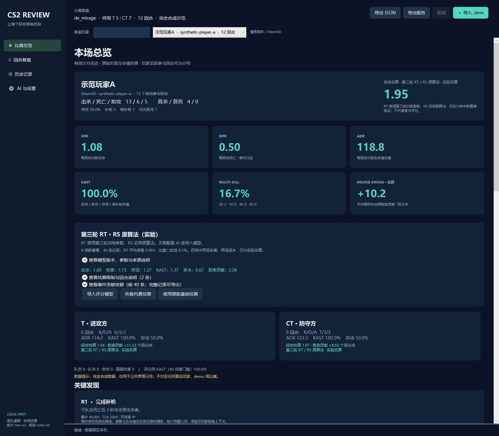

# CS2 Review

一款以近似 **HLTV Rating 3.0** 为目标的 Windows 中文 CS2 评分与复盘软件。导入自己的完整 `.dem`，用职业评分视角查看个人表现：实验 Rating（RT）、Round Swing（RS）、六项子评分，以及原始统计、回合证据与中文复盘。

想看看自己的对局“如果像职业选手那样被评分，会展现什么数据”？CS2 Review 在你实际比赛的记录上模拟这种评分展示，帮助你观察击杀、伤害、存活、多杀和胜率贡献中的长处与不足。

这种模拟使用当前 Demo 的实际记录，对手强度、队伍配合和赛事环境仍以这场比赛为准；结果不能用来预测职业赛场成绩。当前模型属于实验近似，实测误差与适用范围见下方评分说明。

**解析、实验评分和本地复盘都在你的电脑上完成，无需 AI 密钥。** AI 增强报告是可选功能，发送前会展示化名证据并由你确认。

[下载最新 Windows x64 版](https://github.com/wqeopiew/cs2-review/releases/latest) · [评分说明](docs/rating-round3.md) · [统计口径](docs/raw-statistics.md)



截图由真实 WPF 界面渲染，使用匿名合成演示数据；展示界面与功能，不作为比赛统计或评分精度证据。

## 下载与快速开始

1. 在 [Releases](https://github.com/wqeopiew/cs2-review/releases/latest) 下载 `CS2Review-win-x64.zip`，解压到一个文件夹。
2. 保留解压后的完整目录，运行 `CS2Review.exe`。发布包包含 .NET 运行时、本地解析器和地图提取工具，无需另装 SDK。
3. 点击“导入 demo”，选择本地完整比赛 `.dem`，等待解析完成。
4. 在玩家列表中选择目标玩家，也可按昵称或 SteamID 搜索。
5. 查看“总览”和回合复盘；点击事件定位相关证据，使用“导出报告”或“导出 JSON”保存结果。

使用原始统计、本地评分和中文建议不需要联网或配置 AI。压缩包附带 SHA-256 校验文件；如果需要核对下载完整性，可将文件散列与发布页的 `CS2Review-win-x64.zip.sha256` 比较。

## 可以做什么

| 功能 | 内容 |
| --- | --- |
| 原始统计 | K/D/A、KPR、DPR、ADR、KAST、存活率、互斥 2K–5K 多杀、队伤与道具伤害，支持 T/CT 分项 |
| 实验评分 | 本地计算 Rating（RT）与 Round Swing（RS），显示六项子评分、事件贡献、模型身份和不可用原因 |
| 回合复盘 | 开局现金与装备、事件时点的人数、炸弹状态、记录到的火点和位置轨迹；缺失字段显示“未知” |
| 历史对比 | 按 SteamID 和地图查看多场比赛；样本足够时比较最近五场与此前五场，比率按有效参与回合汇总 |
| 中文报告 | 自动生成本地复盘，区分记录事实、可能解释与训练建议；可保存、导出和查看旧报告 |
| 可选地图背景 | 从自己的 CS2 安装只读提取 Mirage 或 Dust2 的背景与静态碰撞资源 |
| 可选 AI 增强 | Qwen、DeepSeek 预设，以及可配置的 OpenAI 兼容文本接口；发送前预览并确认 |

同一 demo 使用同一解析器重复导入时会打开原快照；使用新解析器重新导入会保留新旧版本。历史比较只计算每个 demo 的最新版本，旧比赛和旧报告仍可查看。

## 评分是怎样得到的

默认显示“第三轮 RT · RS 原算法（实验）”。RT 使用内置冻结参数在本机计算，RS 使用本项目原有的概率与贡献分配模型；它们都不是大语言模型临时生成的分数，也不是 HLTV 官方公式。

第三轮 RT 使用 **12 场、120 条官方全图玩家评分**拟合，覆盖 86 位玩家、231 个实际回合。在两个未参与训练的赛事、4 场 40 条玩家记录（35 位玩家、84 回合）上，同一批记录的结果如下：

| 模型 | RT 平均绝对误差（MAE） | RS MAE（百分点） |
| --- | ---: | ---: |
| 原版基础估算 | 0.132395 | 1.636221 |
| 第二轮研究模型 | 0.087992 | 1.636221 |
| 第三轮内置模型 | 0.082624 | 1.636221 |

第三轮 RT 的平均误差比第二轮低 6.1%，但四场中两场改善、两场退步。RS 替代方案未达到预设替换门槛，因此仍保留原算法。**小样本结果不能证明官方等价，也不能保证每场、每位玩家都改善。**

第三轮只更新 RT 的六项权重与截距；胜率形状、经济代理、下包假设和事件贡献分配仍有本项目自己的假设。必要装备、生命值、时钟等事实不足时，评分保持不可用，原始统计仍可查看。详细参数、研究范围与边界见 [第三轮评分说明](docs/rating-round3.md) 和 [基础评分说明](docs/rating-baseline.md)。

软件支持导入有效的实验评分模型，并可“恢复内置估算”或“使用原版基础估算”。发布包提供 `rating-models/round3.json` 和离线校准工具；用法见 [校准工具说明](tools/CS2Review.RatingCalibration/README.md)。切换模型会重新计算当前分数，旧报告保留生成时的模型身份。

## 复盘边界

- 位置轨迹和静态地图只能提供位置参考。Demo 地图版本未知，几何信息缺少真实视点、烟雾与动态门等状态，不能据此认定可见性、预瞄、烟雾封锁效果或安全路线。
- 炸弹倒计时取自 demo 已记录的规则或实体时长；没有记录时显示未知。拆包时钟比较不代表能够安全到达炸弹。
- 事件中的生命与装备是回调时的观测，不能直接当作交战前状态；经济量默认使用冻结结束时的装备总价代理。
- 仅对少量完美、5E 完整 demo 做过验证，尚不能宣称所有平台、地图与录像版本都兼容。不完整或必要状态缺失的录像可能无法导入或无法评分。

## AI 与数据隐私

比赛、报告和缓存保存在本机 `%LOCALAPPDATA%\CS2Review`。公开源码和发布包不包含个人 demo、比赛数据库、密钥、缓存、真实训练录像、官方训练标签或 Valve 游戏地图资源。地图资源由用户从自己的安装中读取。

如果需要 AI 增强，在“AI 与设置”选择提供商并填写 API 地址、模型与密钥。新安装默认使用 Qwen 的 `qwen-plus` 和北京兼容地址 `https://dashscope.aliyuncs.com/compatible-mode/v1`；请按自己的服务地域或业务空间调整地址。已有设置会保留。

点击生成 AI 报告后，软件先展示完整发送内容；只有点击“发送并生成”才发出复盘请求。证据包含选定玩家的统计、必要回合事件、记录到的健康与装备、炸弹状态和少量火点坐标。昵称、SteamID 与证据 ID 会替换为化名，原始 demo、完整轨迹和本地路径不加入证据。**化名不等于完全匿名，比赛细节仍可能使比赛被识别。** API 密钥作为服务认证使用，不加入复盘证据。

密钥由 Windows 凭据管理器按 HTTPS 服务来源保存，切换来源不会自动沿用原密钥。“测试连接”会发送固定合成文字；连接测试、报告和可能的一次校验修复请求都可能产生提供商费用。当前接口使用 OpenAI 兼容的文本协议，尚未适配 Claude/Gemini 专用协议。

本地导出的报告可能包含原始昵称、SteamID 和比赛信息，分享前请自行检查内容。

## 从源码运行

开发环境为 Windows x64。仓库脚本锁定 .NET SDK `10.0.401`、Go `1.27.2` 和地图提取工具版本，将工具解压到项目内 `.tools`，不修改系统 PATH。首次下载工具链及恢复依赖需要联网。

在仓库根目录运行：

```powershell
./scripts/bootstrap.ps1
./scripts/build.ps1 -Publish -SmokeTest
./scripts/run.ps1
```

构建脚本执行 Go 测试与静态检查、Core/Context/Map/Rating/Report 行为测试、校准命令行测试；`-SmokeTest` 额外检查导入与 WPF 交互。开发输出位于 `artifacts/dev`，默认发布目录为 `artifacts/release-round3`，打包结果为 `artifacts/CS2Review-win-x64.zip`。

桌面界面使用 C# / WPF，本地 demo 解析器使用 Go 与 demoinfocs，历史存储使用 SQLite。GitHub Actions 提供 Windows 构建工作流。问题与建议可在 [Issues](https://github.com/wqeopiew/cs2-review/issues) 提交；提供复现步骤时请先检查是否包含个人信息或密钥。

## 许可

项目代码采用 [MIT License](LICENSE)。解析器、地图提取工具、运行时和第三方依赖各自的许可与归属见 [THIRD-PARTY-NOTICES.md](THIRD-PARTY-NOTICES.md) 及发布包的 `licenses`、`map-tools/notices` 目录。
